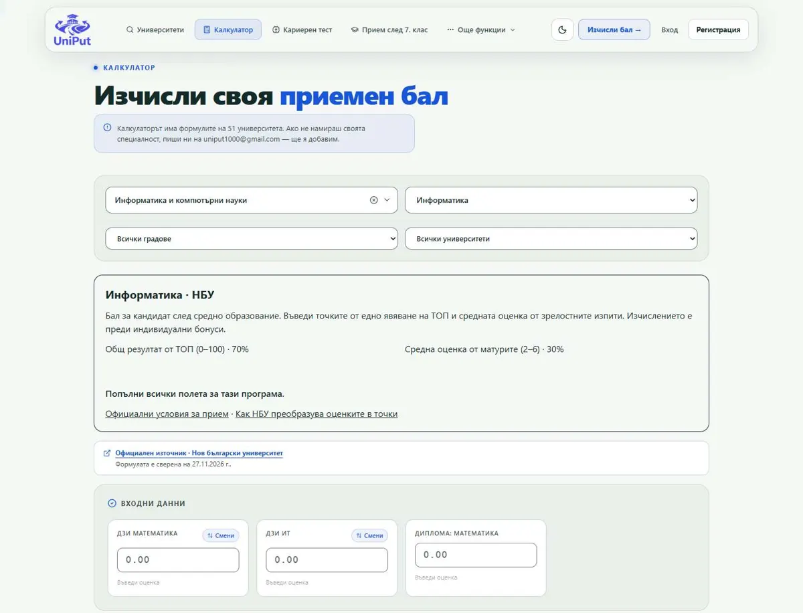
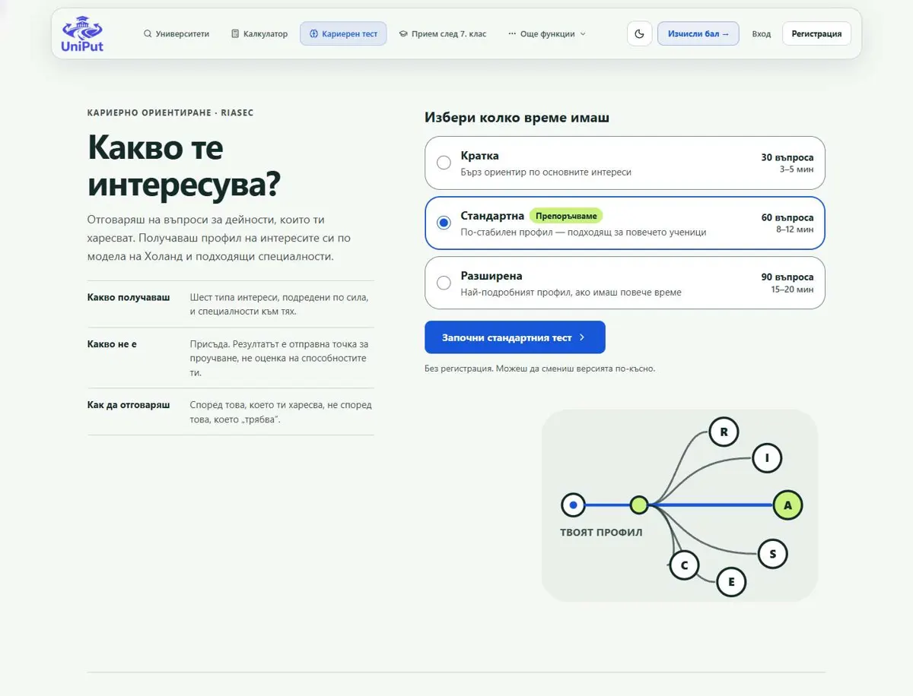
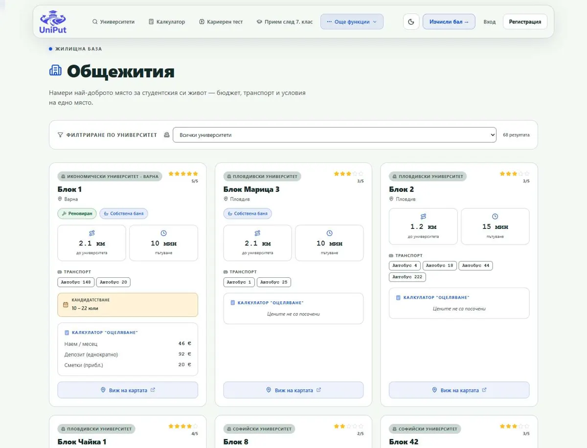

# УниПът — Платформа за Кандидат-Студенти

[](https://github.com/Martin-Atanasov123/Uni-put/actions/workflows/ci.yml)

Безплатна платформа, която помага на български ученици да изчислят приемния си бал, да открият подходяща кариера и да сравнят университети — всичко на едно място.

---

## Функционалности

- **Калкулатор** — изчислява точния приемен бал по официалната формула за всяка специалност, като автоматично избира най-добрата оценка за всеки слот
- **Кариерен съветник** — RIASEC тест в 3 версии (30 / 60 / 90 въпроса), свързващ личностния профил с подходящи специалности (O*NET база)
- **Университети** — търсене и филтриране по университет, факултет, специалност и град
- **Прием след 7. клас** — калкулатор и подреждане на желания за гимназии
- **ДЗИ стратег** — избор на втори ДЗИ според желаните специалности
- **Календар** — срокове за кандидатстване и напомняния
- **Общежития** — карта с общежития, цени и условия
- **Любими** — запазване и сравнение на специалности
- **Моите оценки** — управление на оценки за повторно изчисление
- **Профил** — аватар, RIASEC тип, история

---

## Екрани

| | |
|---|---|
|  |  |
| Начална страница — търсене и пътища за старт | Калкулатор — формулата на конкретната програма и официалният източник |
|  |  |
| Каталог по професионални направления | Специалност — къде се изучава, формула и минимален бал |
|  |  |
| Кариерно ориентиране (RIASEC) — избор на версия | Общежития — наем, разстояние, транспорт |

---

## Технологии

| Компонент | Технология |
|---|---|
| Frontend | React 19 + Vite 6 |
| Routing | React Router 7 (всички маршрути lazy-loaded) |
| Styling | Tailwind CSS 4 + DaisyUI + авторска Modern Academic Premium система |
| Animations | Framer Motion (`motion/react`) — `LazyMotion + domAnimation` |
| 3D | Three.js via `@react-three/fiber` |
| Icons | Lucide React |
| Backend | Supabase (PostgreSQL + Auth + Storage) |
| Tests | Vitest + @testing-library/react |

---

## Маршрути

| Маршрут | Достъп | Описание |
|---|---|---|
| `/` | Публичен | Начална страница |
| `/calculator` | Публичен | Калкулатор на приемен бал |
| `/universities` | Публичен | Каталог на университети и специалности |
| `/universities/:uniSlug` | Публичен | Страница на университет |
| `/specialnosti` | Публичен | Азбучен каталог на специалности |
| `/specialnosti/:specSlug` | Публичен | Страница на специалност |
| `/career-advisor` | Публичен | RIASEC тест и резултати |
| `/dzi-strateg` | Публичен | Стратег за избор на втори ДЗИ |
| `/priem-7-klas` | Публичен | Прием и бал след 7. клас |
| `/dormitories` | Публичен | Общежития |
| `/calendar` | Публичен | Календар и напомняния |
| `/my-grades` | Публичен | Управление на оценки |
| `/about` | Публичен | За проекта |
| `/terms` | Публичен | Условия за ползване |
| `/privacy` | Публичен | Политика за поверителност |
| `/login` / `/register` | Публичен | Автентикация |
| `/forgot-password` / `/update-password` | Публичен | Смяна на парола |
| `/favorites` | Публичен | Запазени специалности; синхронизация след вход |
| `/profile` | Изисква вход | Потребителски профил |
| `/admin` | Изисква админ роля | Управление на данни |
| `/admin/reports` | Изисква админ роля | Доклади |

---

## База данни

Основната таблица е `public.universities` в Supabase:

| Колона | Тип | Описание |
|---|---|---|
| `id` | uuid | Първичен ключ |
| `university_name` | text | Пълно официално название |
| `city` | text | Град |
| `faculty` | text | Факултет / направление |
| `specialty` | text | Специалност (с вид обучение) |
| `education_level` | text | `бакалавър` / `магистър` |
| `formula_description` | text | Четима формула (показва се в UI) |
| `coefficients` | jsonb | Формула като JSONB масив от слотове |
| `max_ball` | numeric | Максимален бал |

### Формат на `coefficients`

Масив от слотове — за всяка алтернатива се изчислява `grade × coef` и се взима максимумът:

```json
[
  {"alternatives": [{"key": "exam_mat", "coef": 3}, {"key": "dzi_mat", "coef": 3}]},
  {"alternatives": [{"key": "mat", "coef": 1}]},
  {"alternatives": [{"key": "diploma", "coef": 1}]}
]
```

Ключовете са дефинирани в [`src/lib/coefficients_config.js`](src/lib/coefficients_config.js) — `exam_*` за приемни изпити, `dzi_*` за ДЗИ, без префикс за оценки от диплома.

Схемата се управлява чрез версионирани SQL миграции в [`supabase/migrations`](supabase/migrations). RLS политиките ограничават достъпа до потребителски данни, а Edge Functions обработват изтриване на профил и напомняния за срокове.

Публичният каталог прилага търсене, филтри и пагинация в PostgreSQL чрез Supabase, а администраторският панел зарежда само текущата страница с точно броене на резултатите. Текстовите полета са с debounce, за да не се изпраща заявка при всяко натискане на клавиш. Рядко променящите се справочни стойности се получават чрез `universities_distinct` и се кешират с ограничен срок.

---

## Визуална система

Основната тема е **Midnight Academic** (`data-theme="dark"`). Светлата **Fresh Academic** тема е достъпна от навигацията и се запазва локално. Дизайнът използва Inter, авторски responsive компоненти, theme-aware анимации и `prefers-reduced-motion`.

---

## Инсталация

Не е нужна инсталация, за да ползваш платформата: тя работи в браузъра на **https://uniput.eu**.

Локално стартиране (изисквания: Node.js 18+, git):

```bash
git clone https://github.com/Martin-Atanasov123/Uni-put.git
cd Uni-put
npm install
```

Копирай `.env.example` като `.env.local` — в него вече са публичният адрес и
анонимният ключ на uniput.eu, така че проектът тръгва без допълнителни настройки.
Никога не използвай `service_role` или secret key във Vite променлива — всичко с
префикс `VITE_` се изпраща към браузъра. Достъпът до данните се контролира от RLS
политиките в базата.

```bash
cp .env.example .env.local
```

```bash
npm run dev        # http://localhost:5173
npm run lint       # проверка на кода (ESLint)
npm run build      # продукционен build
npm test           # тестове
npm run verify:stats     # сверява публичните числа с базата
npm run verify:formulas  # одитира формулите за приемен бал
```

---

## Структура на проекта

Диаграмите и подробният поток на данните са в [`docs/ARCHITECTURE.md`](docs/ARCHITECTURE.md).

```
src/
├── app/              # App.jsx (рутер), main.jsx
├── components/
│   ├── Auth/         # Login, Register, Profile, ForgotPassword, UpdatePassword
│   ├── Calculator/   # Calculator, GradeInputSection, ReportButton
│   ├── CareerAdvisor/# CareerAdvisor, RIASECResults
│   ├── Dormitories/
│   ├── Favorites/
│   ├── MyGrades/
│   ├── Universities/
│   ├── admin/        # AdminDashboard, AdminReports
│   ├── common/       # Header, Footer, Home, About, NotFound, ...
│   └── landing/      # AnoAI, GlobeScene (3D)
├── hooks/            # AuthContext.jsx, useTheme.js
├── lib/              # supabase.js, coefficients_config.js
├── routes/           # ProtectedRoute.jsx, AdminRoute.jsx
└── services/         # universityService.js
```

---

## Алгоритъм на калкулатора

1. Потребителят избира специалност → зарежда се `coefficients` JSON от Supabase
2. За всеки слот се вземат всички въведени оценки, съответстващи на алтернативите
3. За всяка алтернатива се изчислява `grade × coef` (всяка алтернатива носи собствен `coef`); взима се максимумът
4. Сумата от всички слотове е крайният бал
5. Сравнява се с `max_ball / 2` (средният бал) — показва се индикатор "Над/Под средното" с разлика в точки
