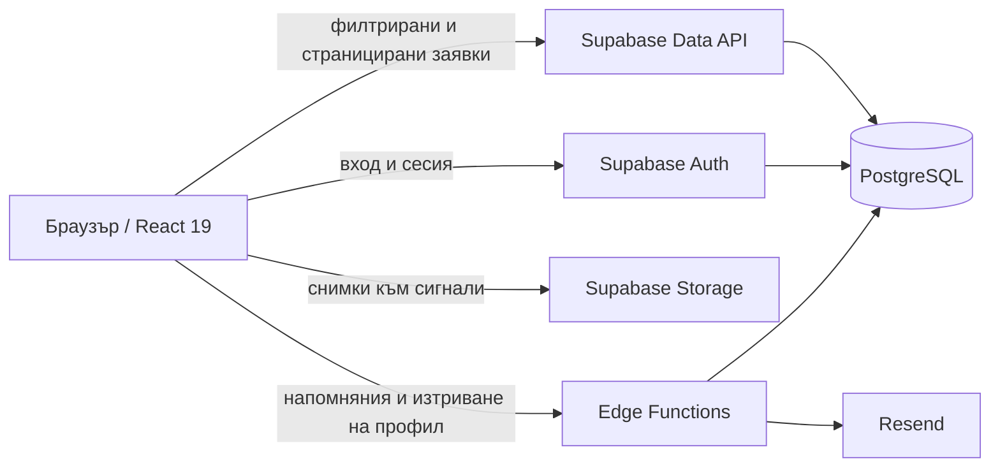
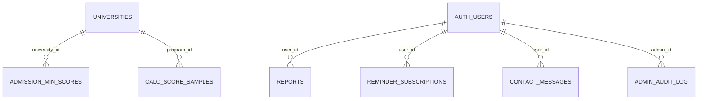

# Архитектура и поток на данните

## Обща архитектура

React маршрутите се зареждат лениво. Публичният каталог не изтегля базата за
локално търсене: заявките съдържат филтри за година, направление (факултети),
град, степен и текст и връщат ограничен диапазон — списъците без текст са по
60 реда с точен общ брой (`count: exact`) и „Покажи още“. Бройките по
направления идват готови от изгледа `catalog_faculty_summary` (по един ред на
факултет, ≈115 реда вместо ≈1300 програми). Търсенето е с 300 ms debounce. Справочните списъци
се получават чрез `universities_distinct`, а стабилните резултати имат TTL кеш.
Калкулаторът зарежда само програмите за избрания факултет и запомня резултата
за повторен избор в рамките на сесията.

Администраторският панел използва сървърно филтриране, `count: exact` и
пагинация по 10 записа. Пълно обхождане се прави единствено при изрично
експортиране и тогава данните се четат на партиди по 1000.

## Основни таблици и връзки

Схемата е сверена с базата (външни ключове от `pg_constraint`, ноември 2026).

Таблици без външен ключ (свързват се по име):
`dormitories` (по име на университет), `admission_events` (по точно име от
`universities`), `university_links`, `specialty_riasec_mapping` и
`careers_riasec_mapping` (по име на специалност), `gymnasium_classes` и
`gymnasium_rankings` (прием след 7. клас).

`universities.id` е UUID. Формулата за всяка програма е в `coefficients`
(JSONB), а `formula_description` е четимото ѝ представяне.

Личните данни на влезлия потребител — любими, история на калкулатора, въведени
оценки, RIASEC тип, план за ДЗИ — се пазят в `user_metadata` на Supabase Auth
(`auth.users`), не в публични таблици: достъп има само самият потребител.
`localStorage` се използва за анонимна работа, предпочитания и временен кеш;
при вход анонимните резултати се сливат с акаунта.

## Надеждност и проверка

- Грешките от заявките се предават към UI error states с повторен опит.
- `GlobalErrorBoundary` предотвратява празен екран при неочаквана React грешка.
- Audit log е в `admin_audit_log`, не в конкретния браузър.
- `universities_duplicate` се премахва от миграция `20261108000100`.
- Формулите са в данните и специализирани scoring модули, покрити с unit тестове.
- `npm run verify:formulas` и `npm run verify:stats` проверяват данните преди release.
